# MyRide

**Ride-hailing, parcel delivery and logistics for Pokhara, Nepal** — built for all 33 wards of Pokhara Metropolitan City, including former Lekhnath (wards 26–33).

MyRide offers motorcycle, car and EV rides, motorcycle parcels, and goods transport (mini-trucks, covered vans, 4×4 jeeps for hill wards, pickups and trucks, with intercity lanes to Kathmandu, Chitwan, Butwal and more). Every passenger fare is calculated to stay **under the Gandaki Province legal maximum** and the national draft cap, with **no surge pricing**, and below the public estimates for Pathao and Yango.

The platform ships as a web stack and as native **iOS & Android** apps built from one codebase — **MyRide** for customers and **MyRide Drive** for riders (the people who drive and earn with MyRide), the way Uber ships Uber and Uber Driver.

> Market research, ward analysis, pricing, unit economics, KYC and payroll design are documented in **[docs/RESEARCH.md](docs/RESEARCH.md)**.

---

## Screenshots

### Mobile apps (Android, live demo fleet)

<table>
  <tr>
    <td align="center">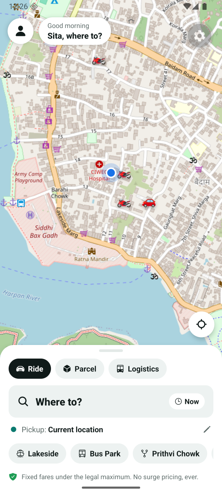<br><sub>Home: your location, nearby riders, quick places</sub></td>
    <td align="center">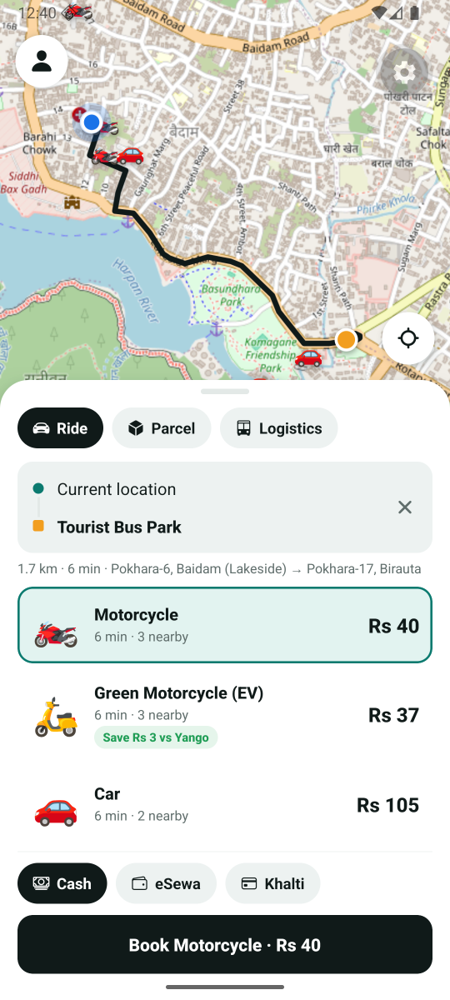<br><sub>Fixed fares, savings vs competitors, one-tap booking</sub></td>
    <td align="center">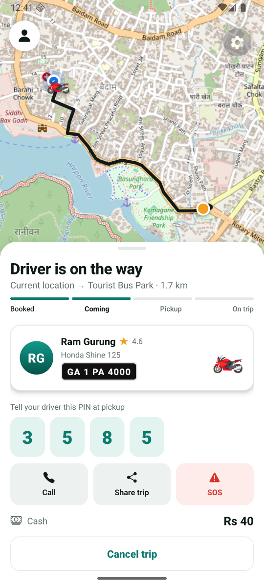<br><sub>Live trip: progress, rider, PIN, SOS</sub></td>
    <td align="center">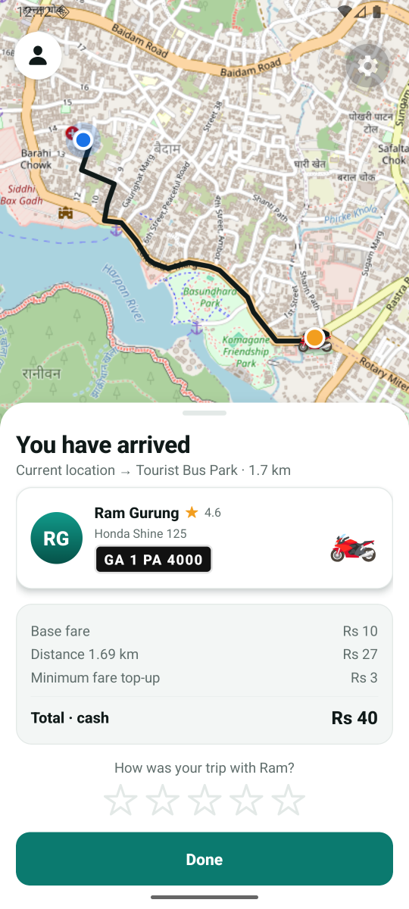<br><sub>Receipt and rating</sub></td>
  </tr>
  <tr>
    <td align="center">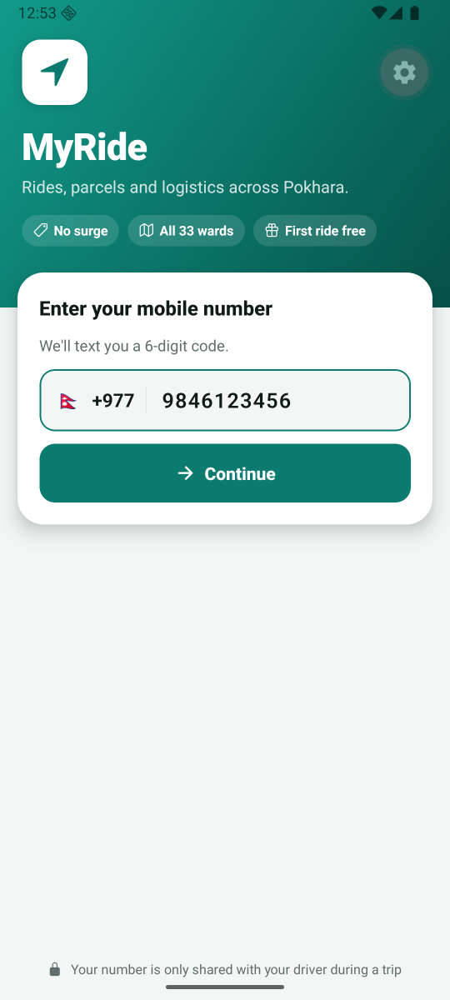<br><sub>Sign in with a +977 number</sub></td>
    <td align="center">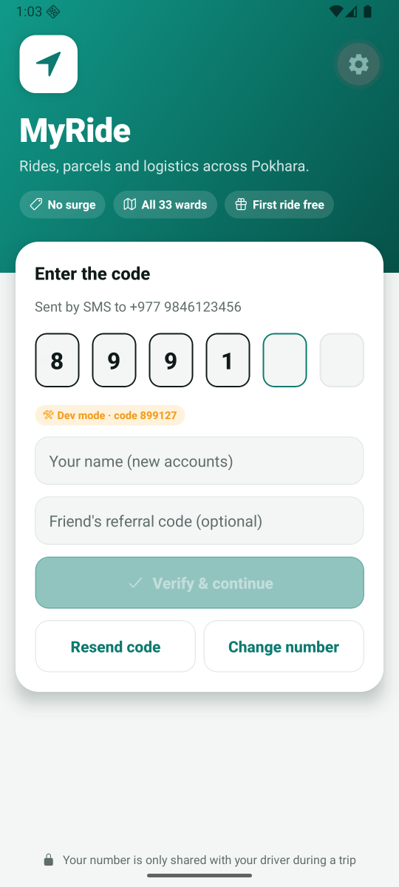<br><sub>SMS code with auto-fill</sub></td>
    <td align="center">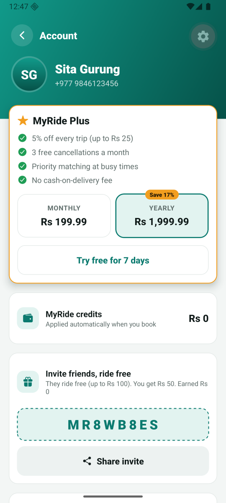<br><sub>MyRide Plus and referrals</sub></td>
    <td align="center">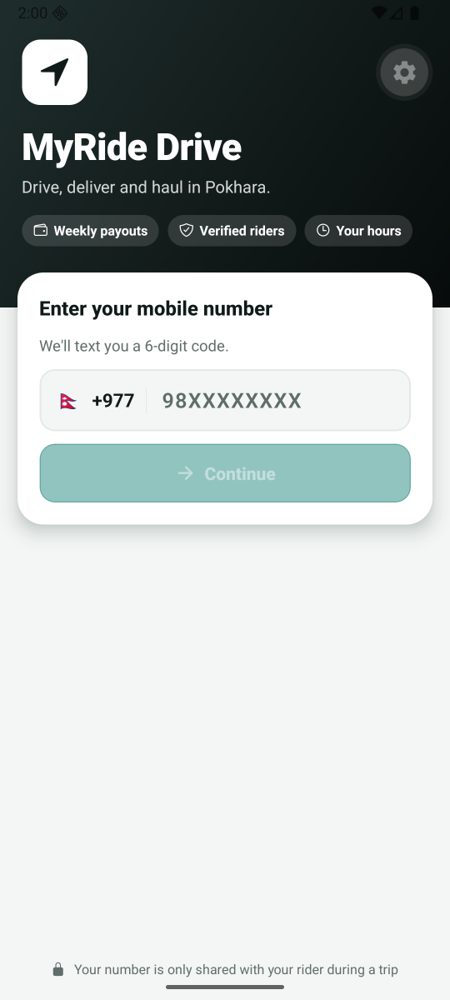<br><sub>MyRide Drive for riders</sub></td>
  </tr>
</table>

<p>
  &nbsp;
  
</p>

### Web portals

| Customer web app — booking from Lekhnath | Fare chart vs legal limits and competitors |
|---|---|
| 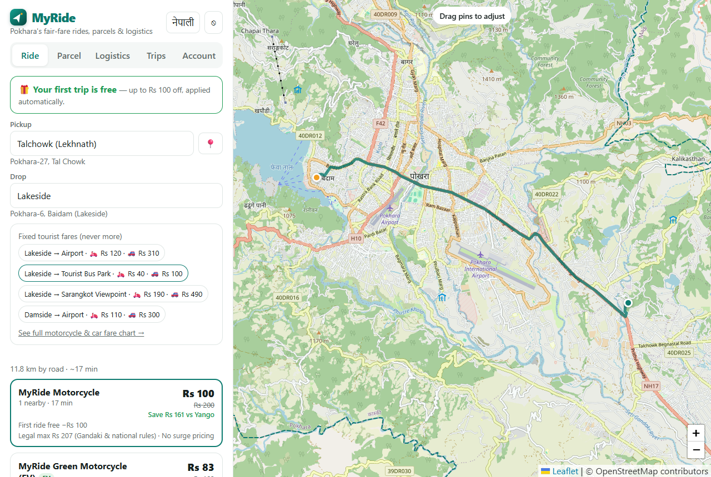 | 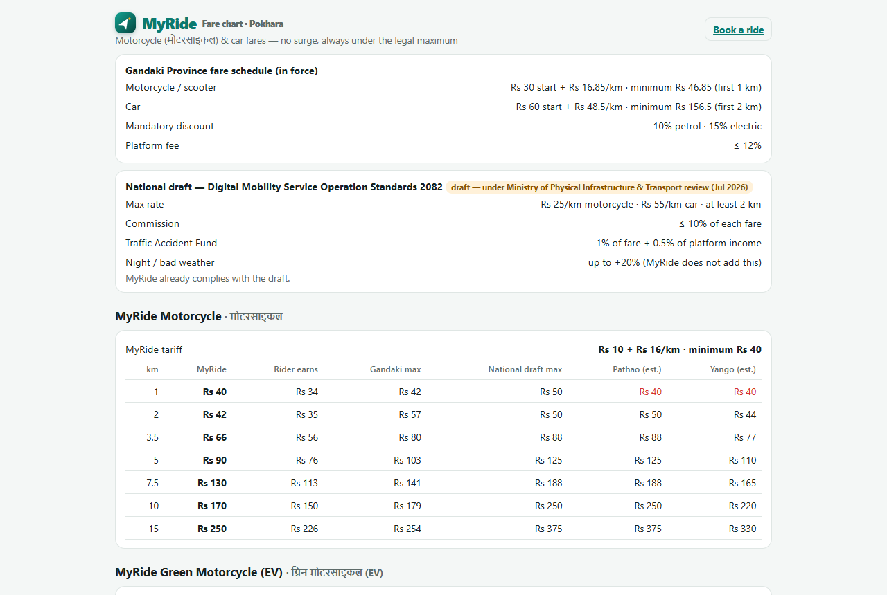 |
| **MyRide Drive — rider application (KYC)** | **Ops — KYC review with document and face-match checks** |
| 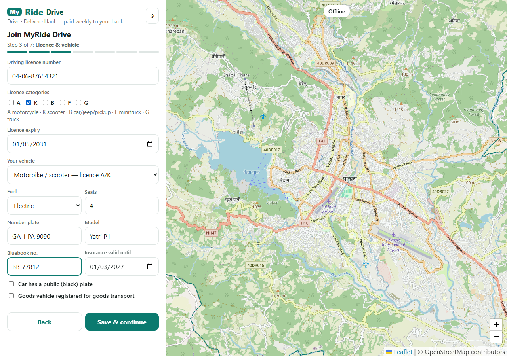 | 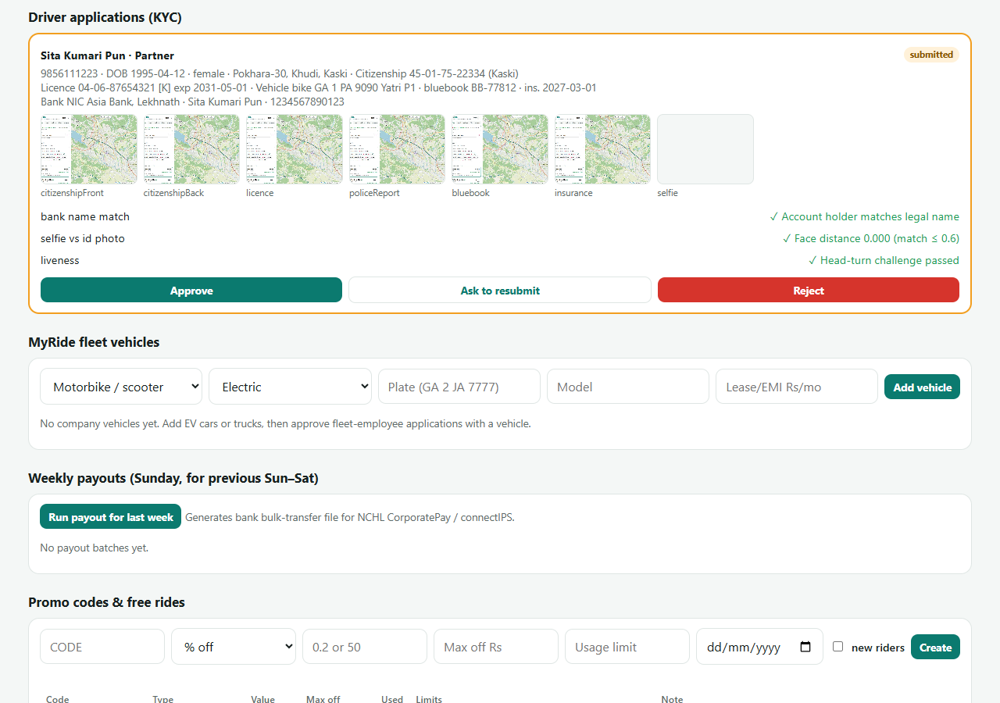 |
| **Ops — live fleet and demand by ward** | **Ops — unit economics and 24-month projection** |
| 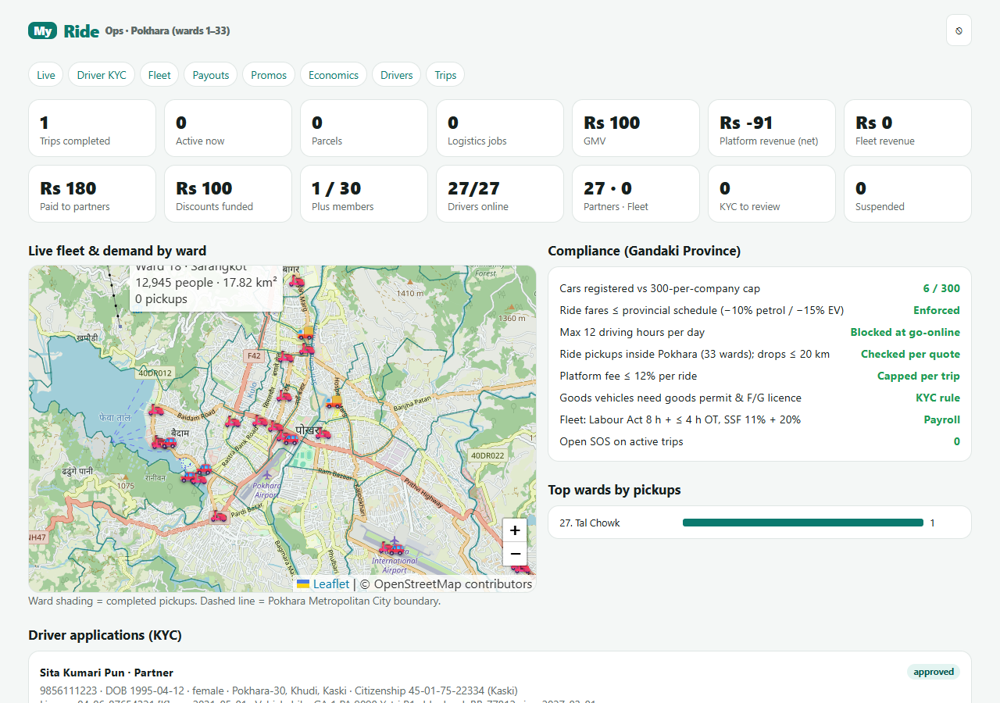 | 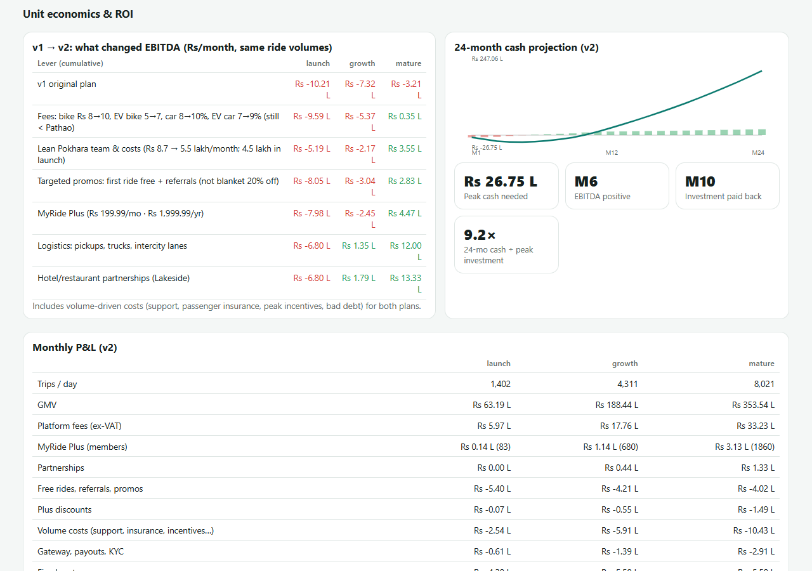 |

---

## Features

### Customers — `MyRide`
- Map opens on your current location; **Where to?** search over landmarks, all 33 wards and intercity destinations.
- **Ride · Parcel · Logistics** quotes in one sheet, showing the legal maximum and the saving versus the cheapest competitor.
- Live rider tracking (instant updates, push notifications when the app is closed), 4-digit trip PIN, share-trip link, SOS (Police 100, Tourist Police 1144, Ambulance 102), ratings.
- **MyRide Plus** (Rs 199.99/month or Rs 1,999.99/year): 5% off every trip, free cancellations, priority matching.
- First ride free (up to Rs 100), referrals (Rs 50 credit), promo codes, business PAN on receipts.
- Payments: cash, eSewa, Khalti (sandbox wired in).

### Riders — `MyRide Drive`
- Riders are partners (own vehicle) or salaried **MyRide Fleet** staff.
- Uber-style **turn-by-turn navigation**: maneuver banner, tilted camera following heading, voice prompts, automatic re-routing.
- Offer cards with countdown, exact earnings and long-pickup bonus; PIN, delivery-code and cash-on-delivery flows.
- **KYC** (citizenship, licence category vs vehicle, police report, bank account) and Uber-style **random selfie checks**.
- **Heading home** filter (2× per day), 12-hour daily limit, weekly payouts to the rider's bank (with SSF/overtime for fleet staff).

### Operations — `MyRide Ops`
- KYC review queue, fleet vehicles, weekly payout batches (NCHL CorporatePay CSV), promo codes, SMS log.
- Live fleet map shaded by ward demand; Gandaki compliance panel; unit economics and ROI projection.

### Logistics
- Mini-truck 750 kg · Cargo van 800 kg (covered) · 4×4 jeep 1 t (recommended automatically for hill wards) · Pickup 1.5 t · Light truck 4 t · Truck 9 t.
- Intercity rates beyond 25 km, loading helpers, goods-in-transit insurance, proof-of-delivery photo.

---

## Architecture

```
            ┌──────────────────────┐       ┌──────────────────────┐
            │  MyRide (iOS/Android)│       │ MyRide Drive (iOS/And)│
            │  Expo · React Native │       │  turn-by-turn nav     │
            └──────────┬───────────┘       └──────────┬───────────┘
                       │  REST (JSON)                 │
 Web: rider · Drive · Ops · fare chart · live tracker │
                       ▼                              ▼
            ┌─────────────────────────────────────────────────────┐
            │ Node.js / Express API  (src/app.js, src/service.js) │
            │ pricing · dispatch · rewards · KYC · payroll · SMS  │
            └───┬───────────────┬────────────────┬───────────────┘
                │               │                │
          OSRM routing    Sparrow / Aakash   eSewa · Khalti
          (OpenStreetMap)  SMS gateways       payments
```

| Layer | Technology |
|---|---|
| API | Node.js 24, Express, Server-Sent Events, JSON store (swap for PostgreSQL/PostGIS) |
| Maps & routing | OpenStreetMap, OSRM, official OSM ward polygons for Pokhara |
| Mobile | Expo SDK 57, React Native 0.86, Expo Router, TypeScript (strict), react-native-maps |
| Web | Vanilla JS + Leaflet; face-api.js for liveness and face matching |
| Messaging | Sparrow SMS / Aakash SMS with failover |

---

## Getting started

### Server and web apps

```bash
npm install
npm run dev     # demo mode: 28 simulated riders across Pokhara accept and drive trips
npm test        # 98 tests
```

| Portal | URL |
|---|---|
| Customer web app | http://localhost:3000/ |
| MyRide Drive | http://localhost:3000/driver.html |
| MyRide Ops | http://localhost:3000/admin.html (dev admin `9800000000`) |
| Fare chart | http://localhost:3000/fares.html |

Without an SMS gateway configured, login codes are shown on screen (development only).

### Mobile apps

Requires **Node ≥ 20.19.4** (Expo SDK 57).

```bash
cd mobile
npm install
npm run start:rider     # MyRide       — scan the QR code with Expo Go, or press "a" for Android
npm run start:driver    # MyRide Drive
npm test                # navigation engine tests
npm run typecheck && npm run lint
```

The apps find the API automatically: same machine as the Expo dev server for phones on Wi-Fi, `10.0.2.2` for the Android emulator, `localhost` for the iOS simulator. Set `EXPO_PUBLIC_API_URL` for anything else.

Field-test navigation on the Android emulator by replaying a real road route through its GPS (noise, speed and a wrong turn to trigger rerouting): accept a trip in MyRide Drive, then run `node tools/gps-replay.js --from lakeside --to mahendrapul --kmh 30 --detour`.

Store builds use EAS profiles (`rider`, `driver`, and `*-preview` APKs): `npx eas-cli@latest build --profile driver --platform android`.

---

## Configuration

| Variable | Purpose |
|---|---|
| `SMS_PROVIDER` / `SMS_FALLBACK` | `sparrow`, `aakash` or `console` (default) |
| `SPARROW_TOKEN`, `SPARROW_FROM` | Sparrow SMS token and NTA-approved sender ID |
| `AAKASH_TOKEN` | Aakash SMS auth token |
| `OTP_SECRET` | HMAC key for stored OTPs (**set in production**) |
| `ANDROID_SMS_HASH` | 11-character app hash for Android SMS auto-fill |
| `ADMIN_PHONES` | Comma-separated admin mobile numbers |
| `ESEWA_*`, `KHALTI_SECRET_KEY` | Payment providers (defaults: public sandboxes) |
| `OSRM_URL` | Routing server (self-host for production) |
| `MYRIDE_FEDERAL_DRAFT=0` | Apply Gandaki rules only (default also complies with the national draft) |
| `GOOGLE_MAPS_ANDROID_KEY`, `GOOGLE_MAPS_IOS_KEY` | Mobile store builds (restrict to the app package / bundle ID) |
| `EXPO_PUBLIC_API_URL` | Mobile API base URL (e.g. `https://api.myride.com.np`) |
| `EAS_PROJECT_ID_RIDER`, `EAS_PROJECT_ID_DRIVER` | EAS project IDs: enable push notifications in the store apps |
| `EXPO_ACCESS_TOKEN` | Only if Expo "enhanced push security" is on |
| `FACE_PROVIDER` | `local` (default, on-device descriptors) or `rekognition` (server-side photo match) |
| `AWS_REGION`, `AWS_ACCESS_KEY_ID`, `AWS_SECRET_ACCESS_KEY`, `FACE_MIN_SIMILARITY` | AWS Rekognition for selfie checks (default `ap-south-1`, 90%) |

---

## Project structure

```
src/            API: config, pricing, dispatch, rewards, KYC, payroll, SMS, economics, geo, app
public/         Web apps: rider, MyRide Drive, Ops, fare chart, live tracker, selfie check
mobile/         Expo app → MyRide + MyRide Drive (src/app = screens, src/lib = API, auth, navigation engine)
data/           Pokhara landmarks, OSRM distance matrix, 33 ward polygons, city boundary
tools/          Scripts that regenerate the geographic data
docs/           Research report and screenshots
test/           Server test suite
```

---

## Production checklist

- [ ] PostgreSQL + PostGIS, Redis pub/sub, encrypted object storage for KYC files with a retention policy
- [ ] `FACE_PROVIDER=rekognition` for selfie checks; add a liveness vendor (e.g. Rekognition Face Liveness) for spoof detection
- [ ] Sparrow/Aakash accounts with an NTA-approved sender ID; strong `OTP_SECRET`
- [ ] eSewa/Khalti merchant keys, Fonepay QR, CorporatePay API
- [ ] Google Maps API keys for the mobile store builds; self-hosted OSRM and map tiles
- [ ] Confirm current Gandaki regulation status and register as an operator

---

## Contributing

Work is tracked in [issues](https://github.com/sailenceresw/myride/issues). Create a branch per issue (`feature/…`, `fix/…`), open a pull request that references it, and make sure `npm test` (root and `mobile/`), `npm run typecheck` and `npm run lint` pass.
